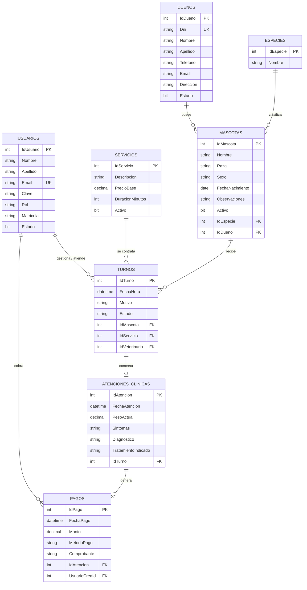

# VetPoint - Sistema de Gestión de Clínica Veterinaria y Turnos

> Propuesta de Proyecto Integrador Final para la materia de Laboratorio de programación 2.

---

## 1. Narrativa del Proyecto y Descripción del Problema

### Datos del Alumno
* **Integrante:** Eros Zamora
* **Repositorio:** [github.com/Eros23z/VeterinariaULP](https://github.com/Eros23z/VeterinariaULP)

---

### Título y Temática
* **Título:** **VetPoint**
* **Temática:** Sistema web para la gestión de una clínica veterinaria, administración de pacientes (mascotas), historial clínico, asignación de turnos y registro de cobros.

---

### Descripción de la Problemática
Actualmente, muchas veterinarias de escala chica o mediana gestionan las agendas de turnos, fichas clínicas y cobros mediante planillas de papel, registros informales en cuadernos o mensajería instantánea fragmentada. Esta modalidad acarrea dificultades operativas críticas:
1. **Pérdida de antecedentes médicos:** No existe una ficha médica unificada por mascota, lo que dificulta el seguimiento de tratamientos, antecedentes quirúrgicos o esquemas de vacunación.
2. **Superposición de turnos y tiempos muertos:** La ausencia de una agenda centralizada por profesional provoca colisiones de horarios entre consultas de rutina, vacunaciones y urgencias.
3. **Falta de trazabilidad financiera:** Los pagos quedan desvinculados de las consultas efectuadas, impidiendo auditar los ingresos diarios y el rendimiento económico por veterinario o servicio prestado.
4. **Desconexión entre el dueño y sus múltiples mascotas:** Dificultad para asociar rápidamente a un cliente con todos los animales a su cargo cuando concurre a la clínica.

---

### Propuesta de Solución
El sistema ofrecerá las siguientes funcionalidades principales:
* **Gestión de Clientes y Mascotas:** Registro completo de los dueños (datos de contacto) y de sus mascotas (especie, raza, sexo, peso, fecha de nacimiento), permitiendo que un dueño posea múltiples animales registrados.
* **Catálogo de Servicios y Especialidades:** Parametrización de los servicios brindados (Consulta General, Vacunación, Desparasitación, Cirugía, Control Postoperatorio) con sus respectivos aranceles sugeridos.
* **Agenda y Gestión de Turnos:** Solicitud y asignación de turnos médicos por fecha, hora y veterinario actuante, validando la no superposición de citas. Manejo de estados del turno: *Pendiente*, *Atendido*, *Cancelado*.
* **Ficha de Atención / Historia Clínica:** Al concretar una cita, el profesional registra el diagnóstico, síntomas observados, peso actual y prescripción médica/tratamiento indicado.
* **Registro de Cobros y Pagos:** Emisión del comprobante de cobro vinculado directamente a la atención realizada, permitiendo asentar montos, medio de pago y estado de cancelación.
* **Módulo de Reportes y Estadísticas:** Consultas avanzadas para el administrador (servicios más demandados en el año, volumen de atenciones por profesional, pacientes sin visita en los últimos 6 meses y facturación por rango de fechas).

---

## 2. Modelo de Datos y Diagrama Entidad-Relación (DER)

### Diagrama Entidad-Relación

Ver diagrama en código Mermaid

## 3. Listado y Descripción de Entidades

* **Usuarios:** Personal del centro veterinario (Administradores, Recepcionistas y Médicos Veterinarios). Almacena credenciales de acceso, rol y número de matrícula profesional.
* **Duenos:** Propietarios de los pacientes. Almacena DNI (clave alternativa única), nombre completo y vías de comunicación (teléfono y correo).
* **Especies:** Tabla maestra normalizada para catalogar a los pacientes (Canino, Felino, Ave, Roedor, etc.).
* **Mascotas:** Animales que reciben asistencia médica. Guarda sus características biológicas y mantiene la pertenencia a un único dueño.
* **Servicios:** Catálogo de prestaciones médicas ofrecidas por la clínica con su costo base sugerido y duración estimada en minutos.
* **Turnos:** Registro cronológico de reservas de agenda médica. Vincula la fecha/hora con el paciente, el servicio solicitado y el veterinario responsable.
* **AtencionesClinicas:** Ficha evolutiva de la consulta médica (historia clínica). Se genera cuando el turno pasa a estado Atendido y registra el diagnóstico técnico, peso y medicación recetada.
* **Pagos:** Registro de la transacción económica resultante de la atención médica realizada, detallando fecha, medio de pago (Efectivo, Tarjeta, Transferencia) y usuario que cobró.

## 4. Descripción de Relaciones
* **Mascotas -> Turnos -> AtencionesClinicas (1 a 1 opcional):** Un turno reserva un espacio temporal en la agenda. No todos los turnos terminan siendo atenciones médicas (pueden ser cancelados o haber inasistencia del paciente). Por lo tanto, la relación entre Turnos y AtencionesClinicas es de 1 a 0..1. La atención médica solo se crea cuando el veterinario examina físicamente al animal, desacoplando la cita administrativa del acto clínico profesional.
* **AtencionesClinicas -> Pagos (1 a 0..1):** El cobro surge como consecuencia de la atención médica brindada (o arancel acordado por procedimientos). Esta vinculación garantiza que ningún pago quede huérfano y que se pueda conocer con exactitud a qué consulta específica correspondió cada importe cobrado.
* **Usuarios (Veterinario) -> Turnos (1 a N):** Permite filtrar las agendas de manera individual para que cada médico veterinario pueda consultar sus compromisos del día sin interferir en la agenda de los demás colegas del establecimiento.